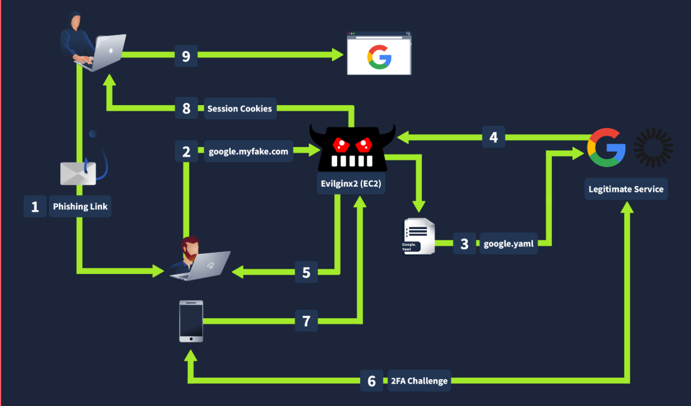

# Common Vulnerabilities in MFA

# Multi-Factor Authentication (MFA) Vulnerabilities & Bypasses

MFA improves security, but poorly designed or implemented MFA mechanisms can still be vulnerable.

Common weaknesses include:

- Predictable OTP generation
- OTP/token leakage
- Missing rate limiting
- Weak verification logic
- Adversary-in-the-Middle (AiTM) phishing

---

## 1. Weak OTP Generation Algorithms

### Mechanism

The security of a **One-Time Password (OTP)** depends on the randomness and security of the algorithm generating it.

### Vulnerability

If the application uses:

- Predictable values
- Weak pseudo-random number generation
- Predictable seeds

then attackers may be able to identify patterns in generated OTPs.

### Impact

Predictable OTPs can allow an attacker to determine or guess valid codes without having access to the victim's device.

### Simple Example

```
Weak Randomness
      ↓
Predictable OTP
      ↓
Attacker identifies pattern
      ↓
Potential MFA bypass
```

---

# 2. Application Leaking the 2FA Token

### Mechanism

The application may accidentally expose the OTP through:

- HTTP responses
- API responses
- XHR/fetch requests
- Debug information
- Client-side JavaScript

### Common Scenario

A user reaches the 2FA page and the browser makes an API request.

```
Browser
   ↓
Request OTP
   ↓
Server
   ↓
HTTP Response
   ↓
OTP accidentally included
```

Instead of securely delivering the OTP through the intended channel, the application accidentally sends it back to the client.

### Impact

An attacker who can legitimately observe the application's traffic may obtain the OTP directly rather than needing to receive or guess it.

### Security Lesson

**Sensitive authentication secrets should never be unnecessarily exposed in client-side responses.**

---

# 3. Brute-Forcing & Lack of Rate Limiting

### Mechanism

OTP verification endpoints should limit how many attempts a user can make.

### Vulnerability

If there is no effective:

- Rate limiting
- Attempt restriction
- Account lockout
- Temporary delay

an attacker may repeatedly submit OTP guesses.

### Impact

An attacker can automate many verification attempts and potentially discover the valid OTP.

### Example

```
OTP Verification
      ↓
No Rate Limit
      ↓
Many Attempts
      ↓
Repeated OTP Guesses
      ↓
Potential MFA Bypass
```

### Security Lesson

MFA verification endpoints should have appropriate **rate limiting and abuse protection**.

---

# 4. Adversary-in-the-Middle (AiTM) Phishing

### Mechanism

An **Adversary-in-the-Middle (AiTM)** attack places an attacker-controlled proxy between the victim and the legitimate website.



The attacker attempts to relay authentication traffic between both sides.

### Simplified Workflow

```
Victim
   ↓
Attacker-Controlled Proxy
   ↓
Legitimate Website
```

The victim may enter:

```
Username
   +
Password
   +
MFA Code
```

The proxy relays the authentication process while attempting to capture authentication information, potentially including an authenticated session.

### Impact

Some MFA methods can be vulnerable to AiTM attacks because the attacker may capture the authenticated session after the victim successfully completes MFA.

This does **not** mean MFA is useless. It means some MFA methods are more resistant to phishing than others.

### Security Lesson

**Phishing-resistant authentication**, such as appropriately deployed passkeys/WebAuthn security keys, is designed to provide stronger protection against AiTM-style attacks.

---

# Vulnerability & Bypass Summary

| Vulnerability / Technique | Cause / Vector | Security Impact |
| --- | --- | --- |
| **Weak OTP Generation** | Predictable randomness or weak algorithms | OTP values may become predictable |
| **Response Token Leakage** | OTP exposed through HTTP/API responses | Authentication token may be disclosed to the client |
| **Lack of Rate Limiting** | Missing attempt restrictions or throttling | Enables repeated OTP guessing |
| **AiTM Phishing** | Attacker-controlled authentication proxy | Can capture credentials and potentially authenticated sessions |

---

# Important Security Testing Checklist

When testing MFA in an **authorized environment**, examine:

- Is the OTP generated securely?
- Is the OTP ever exposed in HTTP responses?
- Is the OTP visible in client-side JavaScript?
- Is there rate limiting on the verification endpoint?
- Is there an account lockout or temporary delay?
- Does the OTP expire quickly?
- Can an OTP be reused?
- Is the OTP tied to the correct user/session?
- Can the MFA step be skipped?
- Can an authenticated session be obtained without completing MFA?
- Does the authentication method provide phishing resistance?

---

# Easy Memory Trick

```
MFA Weaknesses

Predictable OTP
      ↓
Can predict

Token Leakage
      ↓
Can obtain

No Rate Limit
      ↓
Can guess

AiTM
      ↓
Can relay/capture authentication
```

### Key Point

> **MFA is only as strong as its implementation and the authentication method being used.**
>