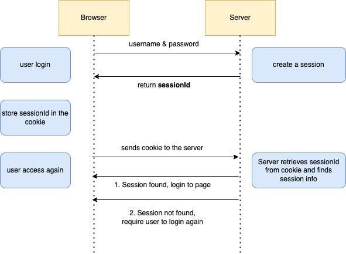

# What is Session Management ?



## 1. What is Session Management?

After you log in, you **do not send your username and password with every request**.

Instead, the website creates a **session** for you.

```
Login
  ↓
Username + Password
  ↓
Server verifies you
  ↓
Session created
  ↓
Session ID / Cookie
  ↓
Used for future requests
```

The session tells the server:

> **“This request belongs to this logged-in user.”**
> 

---

## 2. Why is it needed?

HTTP is **stateless**. This means the server does not automatically remember you between requests.

Without sessions:

```
Request 1 → Username + Password
Request 2 → Username + Password
Request 3 → Username + Password
```

With sessions:

```
Login once
   ↓
Get Session ID
   ↓
Use Session ID
   ↓
Use Session ID
   ↓
Use Session ID
```

---

# 3. Session Management Lifecycle

The session has four main stages:

```
Session Creation
       ↓
Session Tracking
       ↓
Session Expiry
       ↓
Session Termination
```

### 1. Session Creation

When you successfully log in, the server creates a session.

```
Username + Password
        ↓
   Login successful
        ↓
   Session created
```

The session value is then used with future requests.

> **Security concern:** The session ID should be securely generated and stored.
> 

---

### 2. Session Tracking

The browser sends the session value with each request.

```
Request + Session ID
        ↓
      Server
        ↓
Identifies user
        ↓
Checks permissions
```

For example:

```
Session ID → User: Jabbar
             Role: User
```

If session tracking is insecure, an attacker may be able to **hijack the session**.

---

### 3. Session Expiry

A session should not remain valid forever.

Example:

```
Session created
      ↓
Lifetime expires
      ↓
Old session rejected
      ↓
Login again
```

This reduces the damage if a session ID is stolen.

---

### 4. Session Termination

When the user clicks **Logout**, the server should invalidate the session immediately.

```
Logout
  ↓
Session terminated
  ↓
Old session ID no longer works
```

If logout does not properly terminate the session, an attacker who has the session ID may continue accessing the account.

---

# 4. Authentication vs Authorization

These are very important for session management.

### Authentication = Who are you?

```
Username + Password
        ↓
   Verify identity
```

### Authorization = What can you do?

```
Normal User → View profile

Admin → View profile + Manage users
```

**Remember:**

> 🔐 **Authentication = Who are you?**
> 
> 
> 🛡️ **Authorization = What are you allowed to do?**
> 

---

# 5. Session Hijacking

If an attacker obtains a valid session ID, they may be able to **impersonate the user** without knowing their password.

```
Victim logs in
      ↓
Session ID created
      ↓
Attacker obtains session ID
      ↓
Attacker sends session ID
      ↓
Server thinks attacker = victim
```

This is called **Session Hijacking**.

---

## ⭐ THM Important Points

| Term | Simple meaning |
| --- | --- |
| **Session** | Keeps a user logged in |
| **Session ID** | Identifies the user's session |
| **Session Creation** | Creates a session after authentication |
| **Session Tracking** | Uses the session to identify the user |
| **Session Expiry** | Automatically invalidates an old session |
| **Session Termination** | Invalidates the session after logout |
| **Session Hijacking** | Attacker takes over a valid session |
| **Authentication** | Identifies the user |
| **Authorization** | Determines what the user can access |

### One-line definition

> **Session management securely creates, tracks, expires, and terminates a user's session so the application can maintain authentication securely.**
>