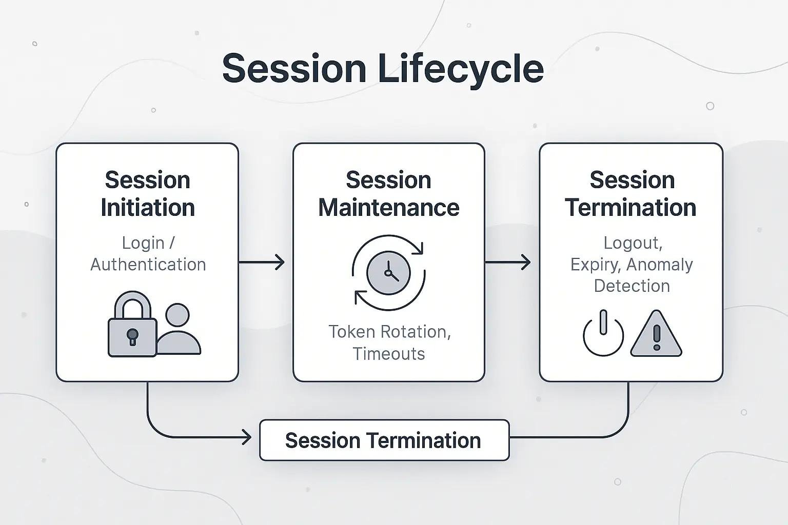

# Securing Session LifeCycle

Session Management Security



Session security means making sure the **session cannot be guessed, stolen, misused, or kept forever**.

The four stages are:

```
Session Creation
       ↓
Session Tracking
       ↓
Session Expiry
       ↓
Session Termination
```

---

## 1. Session Creation

This is where many vulnerabilities can happen.

### A. Weak Session Values

A session ID should be **random and difficult to guess**.

Bad example:

```
username = admin
       ↓
Base64
       ↓
YWRtaW4=
       ↓
Session ID
```

An attacker who understands this process may generate another user's session ID.

**Key point:**

> Session values must be unpredictable and securely generated.
> 

---

### B. Controllable Session Values

Some tokens, such as **JWTs**, contain information used to verify the token.

If the application does not properly verify the token's **signature**, an attacker may be able to create or modify their own token.

**Key point:**

> Always securely verify token integrity and signatures.
> 

---

### C. Session Fixation

The application gives the user a session **before login**.

If the session ID does not change after login:

```
Attacker gets session ID
        ↓
Victim uses same session
        ↓
Victim logs in
        ↓
Session ID stays the same
        ↓
Attacker may use that session
```

**Protection:** Generate a **new session ID after authentication**.

---

### D. Insecure Session Transmission

Sometimes authentication and application servers are separate, such as with **SSO**.

If the session information is transferred through an insecure or attacker-controlled redirect, the session may be exposed.

**Key point:**

> Session information must be transferred securely and redirects must be properly validated.
> 

---

# 2. Session Tracking

The server must correctly connect:

```
Session → User → Permissions → Requested Action
```

### Authorization Bypass

There are two important types:

### Vertical Authorization Bypass

A normal user performs an action meant for a higher-privileged user.

```
Normal User
    ↓
Access Admin Function ❌
```

Example: A normal user deletes another account.

### Horizontal Authorization Bypass

The user is allowed to perform the action, **but on someone else's data**.

```
User A
 ↓
Allowed to view profile
 ↓
Changes request to User B's profile ❌
```

This is especially important in web security and is closely related to **IDOR/BOLA**.

**Key point:**

> The server must check the logged-in user, the requested data, and whether that user owns or can access that data.
> 

---

### Insufficient Logging

Applications should record important actions, including:

```
User
Session ID
Action
Time
Result
```

Both **successful and rejected actions** should be logged.

Why?

If an attacker hijacks a valid session, their requests may look completely legitimate. Logging only rejected requests would miss those actions.

---

# 3. Session Expiry

The main problem is an **excessively long session lifetime**.

Example:

```
Banking → Shorter session
Webmail → May use longer session
```

Why?

If someone steals a session, they can use it until it expires.

For long-lived sessions, applications can also monitor unusual changes such as location/device information and terminate suspicious sessions.

**Key point:**

> Session lifetime should match the application's security requirements.
> 

---

# 4. Session Termination

When the user clicks **Logout**, the server should invalidate the session.

Bad:

```
Logout
 ↓
Browser removes cookie
 ↓
Server still accepts session ❌
```

Good:

```
Logout
 ↓
Server invalidates session
 ↓
Old session rejected ✅
```

This is especially important if an attacker has already stolen the session.

### Password Reset

After a successful password reset, it is good practice to **terminate existing sessions**, helping the legitimate user regain control of the account.

---

# ⭐ Quick Revision Table

| Stage | Main Vulnerability | Simple Meaning |
| --- | --- | --- |
| **Creation** | Weak session | Session can be guessed |
|  | Controllable token | Attacker may create/modify token |
|  | Session fixation | Old session remains after login |
|  | Insecure transmission | Session exposed during transfer |
| **Tracking** | Vertical bypass | Normal user gets admin access |
|  | Horizontal bypass | User accesses another user's data |
|  | Insufficient logging | Cannot reconstruct the attack |
| **Expiry** | Excessive lifetime | Stolen session works too long |
| **Termination** | Improper logout | Old session remains valid |

### 🧠 Easy Memory

**Creation → Can I guess/steal it?**

**Tracking → Can I use it for something I shouldn't?**

**Expiry → Does it remain valid too long?**

**Termination → Does logout actually kill it?**

### One-line exam answer

> **Session management security protects sessions throughout their lifecycle by preventing weak or fixed session values, authorization bypasses, excessive session lifetime, insecure transmission, and improper termination.**
>